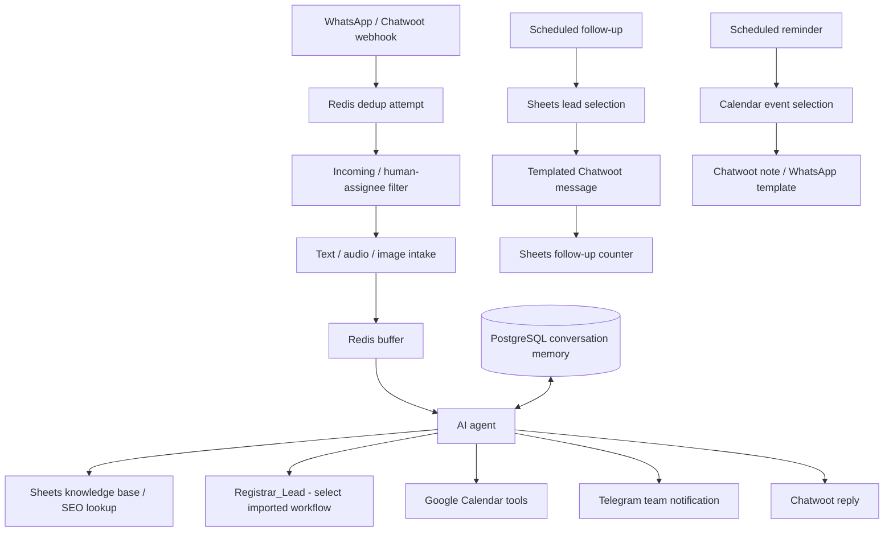

# WhatsApp AI Pre-Sales Agent

**AI pre-sales orchestration for WhatsApp lead qualification, meeting booking and human handoff.**

Designed around an agency pre-sales workflow, this project connects **n8n, OpenAI, Chatwoot, Google Calendar, Google Sheets, PostgreSQL, Redis and Telegram**. Four sanitized workflow exports show how inbound conversations move from multimodal intake to qualification, scheduling and team follow-up.

## Evidence you can inspect

- [Four workflow exports](workflows/), including the lead-registration subworkflow.
- [Local tests](tests/) that load exported JavaScript and exercise synthetic cases without credentials or paid calls.
- [Lead-registration contract](docs/lead-registration.md) covering partial updates, row targeting and separate integration statuses.
- The architecture and design decisions below explain the intended behavior and engineering trade-offs.

## What it does

- **Multimodal intake:** text, audio transcription and GPT-4o image-analysis paths.
- **Qualification:** tool-based service/intent rules, knowledge lookup and heuristic lead scoring.
- **Lead registration:** Sheets lookup and partial field preservation on create/update paths.
- **Conversation memory:** PostgreSQL chat history keyed by sender.
- **Buffering and deduplication:** Redis mechanisms for incoming message handling.
- **Meeting coordination:** Calendar lookup, creation with Meet and update tools.
- **Follow-ups and reminders:** deterministic templates and scheduled event selection.
- **Human handoff:** Telegram notifications and an incoming/human-assignee filter.

## Architecture




The diagram maps the exported workflows; live integration validation is a separate staging step.

## Design decisions

### Keep commercial closing with people

The agent qualifies and coordinates; it does not close sales, collect payment or approve exceptional requests. Proposals and commercial judgment stay with the team. Telegram notifications support escalation, but are not a durable handoff lock.

### Use deterministic follow-up templates

Follow-up copy is selected by stage, service interest, counter and elapsed time rather than generated freely by an LLM. This makes message-selection rules inspectable and testable; delivery and messaging-window checks still need staging validation.

### Separate transient coordination from conversation history

Redis handles buffering and deduplication attempts; PostgreSQL holds conversational memory. These are different state lifecycles. The current Redis pattern is not atomic and does not guarantee exactly-once processing.

### Fail closed on conversion events

Meta CAPI is unconditionally blocked until trusted consent and durable idempotency are implemented. Chatwoot label mutation is disconnected until a safe merge strategy exists. These are explicit integration boundaries, not completed features.

## Included workflows

- [01-main-intake-agent.json](workflows/01-main-intake-agent.json): intake, qualification, tools, memory and replies.
- [02-lead-registration.json](workflows/02-lead-registration.json): Sheets lookup, partial merge and create/update.
- [03-followup-24h.json](workflows/03-followup-24h.json): follow-up selection targeting 6–24 hours since the CRM interaction timestamp.
- [04-appointment-reminder.json](workflows/04-appointment-reminder.json): weekday reminders with locally tested event-selection logic.

## Run the tests locally

Use a supported Node.js release with `node:test` (Node 22 or newer recommended):

```bash
node --test tests/*.test.cjs
```

Tests check JSON/graph structure and execute actual exported JavaScript with synthetic fixtures. Coverage includes reminder selection, CDMX date boundaries, invalid inputs, partial field preservation, row-number targeting, RAW string mappings, CAPI blocking and response classification.

No credentials, network calls, paid APIs or n8n runtime are used. These tests are evidence of local behavior, not live delivery or business performance. Hosted CI is not configured; the harness is not a sandbox for arbitrary untrusted code.

## Staging setup

<details>
<summary>Configure an isolated n8n staging instance</summary>


**Do not import these exports into a production instance and immediately activate them.**

1. Use an isolated staging n8n instance and non-production accounts. The exact compatible n8n version has not been established; inspect node `typeVersion` values and verify them against your installation.
2. Import the exports with workflows inactive. No n8n provisioning, Redis/PostgreSQL deployment or database migration is bundled.
3. Add credentials using n8n's credential store: OpenAI, Calendar OAuth, Sheets OAuth, Telegram, Redis and PostgreSQL. Do not commit credentials or a populated environment file.
4. Replace `YOUR_*` placeholders and reserved `*.example.com` URLs. Review hardcoded Chatwoot account `1` and inbox `2`; they must match staging, not be accepted as safe defaults.
5. Import the included `workflows/02-lead-registration.json`, then select that imported workflow in the primary workflow's `Registrar Lead` tool, replacing `YOUR_REGISTRAR_LEAD_WORKFLOW_ID`. Verify input/output mappings, Sheets headers and row-number behavior in staging. Review [lead-registration semantics and integration options](docs/lead-registration.md) before enabling any optional integration; leave CAPI blocked and Chatwoot labels disconnected until their prerequisites are implemented. Local preservation tests do not validate Sheets runtime behavior or concurrent writes.
6. Configure restricted OAuth scopes, webhook authentication/origin verification, attachment egress controls, data retention and approved WhatsApp template `confirmacion_cita`. See [security boundaries](docs/security.md).
7. Run local tests, then synthetic integration/smoke tests for intake, lead writes, booking, handoff, reminders and follow-up delivery. Verify permissions, failures, duplicates and message-window rules before any activation.

</details>

## Limitations and next steps

- **Export versus deployment:** all exports are inactive; bind the imported lead-registration workflow ID and validate n8n/provider compatibility before activation. No end-to-end runtime or commercial performance is claimed.
- **CRM consistency:** Sheets read/merge/write is non-atomic and vulnerable to concurrent edits or row movement. CAPI is blocked and Chatwoot label mutation remains disconnected.
- **Trust and authorization:** webhook verification, calendar ownership, deterministic tool guards, attachment restrictions and multi-account memory isolation need implementation.
- **Recovery and handoff:** deduplication/buffering are non-atomic; durable handoff, comprehensive failure recovery and retention/deletion remain work to do.
- **Messaging correctness:** follow-up counters can advance after failed sends; validate the latest-inbound timestamp, messaging window, reminder ownership, delivery idempotency and note/send ordering.
- **Runtime configuration:** reconcile voice-call policy and Meet/attendee settings; validate debounce expressions and timestamp formats in staging.

See [security and hardening requirements](docs/security.md) and [example provenance and publication notes](docs/provenance.md) for details. Catalog terms are illustrative, not a current commercial offer; do not use synthetic examples as testimonials or measured outcomes.

## Authorship and license

Eduardo Ayala owns this portfolio project and its workflow design/configuration; AI tools assisted with code, documentation and review. Connected services and n8n implementations belong to their respective authors/providers.

[MIT](LICENSE) covers repository code, configuration and documentation, not third-party service access, trademarks or customer-data rights.
