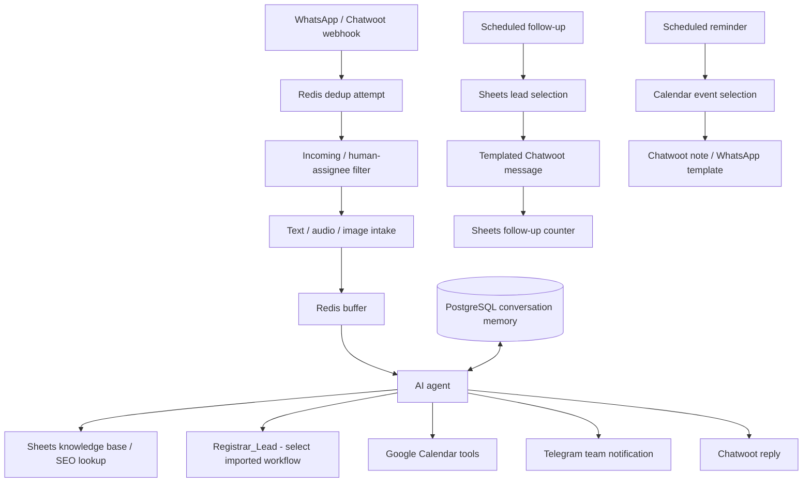

# WhatsApp AI Pre-Sales Orchestration

**An n8n-based portfolio project by [Eduardo Ayala](https://github.com/eduardoayalaq04), focused on Applied AI and GTM workflow engineering.**

This repository contains sanitized workflow exports for WhatsApp pre-sales: multimodal intake, lead qualification, conversation memory, appointment scheduling, follow-up eligibility and team notifications. The design combines **n8n, OpenAI, Chatwoot, Google Calendar, Google Sheets, PostgreSQL, Redis and Telegram**.

**The agent does not close sales or collect payment.** Commercial closing, proposals and exceptional requests are handed to people. That human boundary is intentional.

> **Status: portfolio reference, not a production-ready deployment.** All four exports, including the `Registrar_Lead` dependency, are included and saved with `active: false`. Select the imported lead-registration workflow in the caller: its ID is still a placeholder. Local tests exercise exported JavaScript and static configuration; no n8n runtime, provider compatibility, delivery or business performance has been validated. CAPI is unconditionally blocked and Chatwoot label mutation is disconnected.

## What is represented in the exports

- **Multimodal intake:** text, audio-transcription and GPT-4o image-analysis paths. The transcription node does not explicitly pin a model; GPT-4o is not claimed as the audio transcription model.
- **Tool-based qualification:** service/intent rules, heuristic lead scoring, knowledge-base lookup and a call to the included lead-registration subworkflow (requires selecting its imported workflow ID).
- **Lead registration:** partial merge into Sheets preserves existing mapped fields for absent, `null`, literal `'null'` or blank input; updates target a validated `row_number`, with RAW string cell values. This is not an atomic upsert and does not protect against concurrent row movement. CAPI and Chatwoot labels are not completed integrations; see the [contract and integration options](docs/lead-registration.md).
- **Conversation memory:** PostgreSQL chat-memory configuration, keyed by sender; Redis is used separately for buffering and deduplication.
- **Appointment tools:** calendar lookup, creation with Meet and update operations. Ownership and scheduling guards need deterministic enforcement before production use.
- **Follow-ups:** deterministic templates selected by lead stage, service interest, counter and elapsed time; not LLM-generated follow-up copy.
- **Human handoff:** Telegram notification and an incoming/human-assignee check. Notification is not a durable handoff lock.
- **Operational mechanisms:** Redis buffering/deduplication, retries and an agent-error fallback. These are implemented patterns, not guarantees of exactly-once processing or comprehensive fault handling.

## Architecture



The diagram describes the exported topology, including limitations; it is not evidence of an end-to-end successful run.

## Included workflows

- `AgencyBot - Flujo 1 v3.json`: primary intake, agent, tools, memory and response workflow.
- `AgencyBot - Followup 24hrs v4.json`: follow-up eligibility targeting 6–24 hours since the CRM interaction timestamp. Production use requires proving that timestamp represents the latest inbound message and rechecking the messaging window.
- `AgencyBot - Confirmar Cita.json`: weekday reminder workflow with locally tested event-selection logic.
- `AgencyBot - Registrar Lead v4.json`: agent-tool dependency for Sheets lookup, partial merge and create/update. It returns separate `crm_status`, `capi_status` and `labels_status`; CAPI is always blocked without payload construction or hashing, and Chatwoot labeling is disconnected to avoid destructive replacement. Changing `enabled` does not enable CAPI sends. Trusted consent and a durable idempotency ledger remain to be implemented.

## Local tests — no credentials or paid calls

Use a current supported Node.js release with `node:test` (Node 22 or newer recommended):

```bash
node --test tests/*.test.cjs
```

Tests load actual exports, check JSON/graph structure and execute reviewed code with synthetic fixtures, without credentials, network calls or an n8n runtime. Reminder cases use a fixed clock and cover event selection, CDMX date boundaries, invalid events, URLs and conversation markers. Lead-registration cases cover input validation, partial preservation, ambiguity, row-number targeting, RAW string mappings, unconditional CAPI blocking and response classification. Mocked provider responses are not proof of live delivery. The harness is for these reviewed local fixtures, not a security sandbox for arbitrary untrusted code.

There is no hosted CI configured. No conversion lift, latency, cost savings, scoring accuracy or live integration pass rate is claimed.

## Safe staging setup

**Do not import these exports into a production instance and immediately activate them.**

1. Use an isolated staging n8n instance and non-production accounts. The exact compatible n8n version has not been established; inspect node `typeVersion` values and verify them against your installation.
2. Import the exports with workflows inactive. No n8n provisioning, Redis/PostgreSQL deployment or database migration is bundled.
3. Add credentials using n8n's credential store: OpenAI, Calendar OAuth, Sheets OAuth, Telegram, Redis and PostgreSQL. Do not commit credentials or a populated environment file.
4. Replace `YOUR_*` placeholders and reserved `*.example.com` URLs. Review hardcoded Chatwoot account `1` and inbox `2`; they must match staging, not be accepted as safe defaults.
5. Import the included `AgencyBot - Registrar Lead v4.json`, then select that imported workflow in the primary workflow's `Registrar Lead` tool, replacing `YOUR_REGISTRAR_LEAD_WORKFLOW_ID`. Verify input/output mappings, Sheets headers and row-number behavior in staging. Review [lead-registration semantics and integration options](docs/lead-registration.md) before enabling any optional integration; leave CAPI blocked and Chatwoot labels disconnected until their prerequisites are implemented. Local preservation tests do not validate Sheets runtime behavior or concurrent writes.
6. Configure restricted OAuth scopes, webhook authentication/origin verification, attachment egress controls, data retention and approved WhatsApp template `confirmacion_cita`. See [security boundaries](docs/security.md).
7. Run local tests, then synthetic integration/smoke tests for intake, lead writes, booking, handoff, reminders and follow-up delivery. Verify permissions, failures, duplicates and message-window rules before any activation.

## Example content, privacy and provenance

`YourAgency` and the `*.example.com` destinations are placeholders. The prompt's catalog, prices, schedules, delivery periods and financing terms are **illustrative configuration**, not a current commercial offer. Published customer success stories and third-party comparisons have been removed from the current export; do not invent testimonials or project impact.

Credentials and deployment identifiers in these exports are placeholders; `pinData` is empty. This does **not** make the workflow safe to expose publicly as an unauthenticated service. Public GitHub ownership and authorship remain visible. A local-machine author address exists in the initial commit; it is not a credential, and this update does not erase Git history. Earlier revisions also retain the previous prompt content. See [publication and history notes](docs/security.md).

**Authorship:** Eduardo owns this portfolio project and its workflow design/configuration. AI tools assisted with code, documentation and review. The sanitized exports demonstrate the integration design; claims about live deployment, exclusive originality or measured commercial outcomes require separate evidence. n8n node implementations and connected services remain the work of their respective authors/providers.

## Known limitations and next work

- Lead-registration dependency is included but needs caller binding and end-to-end validation; Sheets read/merge/write is non-atomic and vulnerable to concurrent edits or row movement.
- CAPI has no trusted consent integration or durable idempotency ledger and is unconditionally blocked; Chatwoot labels lack a safe concurrent merge and remain disconnected.
- Webhook trust, calendar ownership and tool authorization are not enforced by prompt instructions.
- Non-atomic deduplication/buffering and incomplete failure recovery.
- Follow-up counter can advance after failed delivery; its timestamp/count validation needs hardening.
- Reminder selection is fixed and tested, but external event ownership, delivery idempotency and note/send ordering remain unresolved.
- Voice-call policy and Meet/attendee configuration need reconciliation; debounce expressions and input timestamp formats need runtime validation.
- Multi-account memory isolation, durable handoff, retention/deletion and attachment restrictions need implementation.

These are tracked as [production hardening requirements](docs/security.md), not presented as completed safeguards.

## License

[MIT](LICENSE) for repository code, configuration and documentation. No trademark rights, third-party service rights, customer-data rights or connected-service access are granted.
